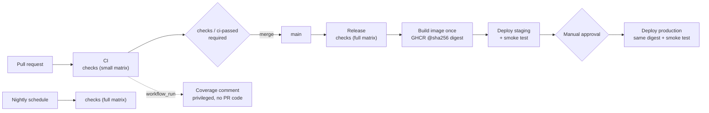

# Taskflow

[](https://github.com/OWNER/taskflow/actions/workflows/ci.yml)
[](https://github.com/OWNER/taskflow/actions/workflows/release.yml)
[](https://github.com/OWNER/taskflow/actions/workflows/nightly.yml)

A small to-do API (FastAPI) with a **production-grade GitHub Actions CI/CD pipeline**:
every pull request is linted, type-checked and tested; every merge is built once into an
immutable container image, deployed to staging, smoke-tested, and promoted to production
after manual approval.

**Live:** [staging](https://STAGING-URL) · [production](https://PRODUCTION-URL) ·
each `/health` endpoint reports the deployed commit SHA.

## The pipeline



| Workflow | Trigger | What it does |
|---|---|---|
| [`ci.yml`](.github/workflows/ci.yml) | Pull requests | Calls `checks.yml` with a fast Linux matrix; cancels superseded runs |
| [`checks.yml`](.github/workflows/checks.yml) | Called (reusable) | Lint (ruff), strict types (mypy), workflow lint + security scan (actionlint, zizmor), tests on Python 3.12–3.14 (+ Windows in full mode), coverage artifacts, a single gate job |
| [`release.yml`](.github/workflows/release.yml) | Push to `main` | Full checks → build and push image → staging → approval → production, each deploy verified by a smoke test |
| [`nightly.yml`](.github/workflows/nightly.yml) | Daily schedule | Full cross-platform matrix against `main` |
| [`coverage-comment.yml`](.github/workflows/coverage-comment.yml) | After CI | Posts coverage on PRs (fork-safe: never executes PR code) |

**Security and reliability practices:** least-privilege `permissions:` per job ·
all actions pinned to commit SHAs and kept current by Dependabot (7-day cooldown) ·
`persist-credentials: false` on checkout · environment-scoped deploy secrets ·
protected production environment with required reviewer · deploys by immutable image
digest · per-environment concurrency (deploys queue, never cancel) · job timeouts ·
composite actions for setup and deploy logic.

## Run it locally

```bash
python -m venv .venv && source .venv/bin/activate   # Windows: .venv\Scripts\Activate.ps1
pip install -r requirements-dev.txt
ruff check . && mypy && pytest -v
uvicorn app.main:app --reload                        # http://localhost:8000
```

Or with Docker: `docker build -t taskflow . && docker run -p 8000:8000 taskflow`.

## API

| Method | Path | Description |
|---|---|---|
| `GET` | `/health` | Status and deployed version (commit SHA) |
| `GET` | `/api/todos` | List to-dos |
| `POST` | `/api/todos` | Create `{"title": "..."}` |
| `GET` | `/api/todos/{id}` | Get one |
| `PATCH` | `/api/todos/{id}` | Update `{"title"?, "done"?}` |
| `DELETE` | `/api/todos/{id}` | Delete |

Data is in memory by design: the project's focus is the delivery pipeline.

## Repository layout

```
app/                    FastAPI app + minimal web UI
tests/                  pytest suite
Dockerfile              non-root production image; APP_VERSION baked in at build
.github/workflows/      the pipeline (see table above)
.github/actions/        composite actions: setup-python-project, deploy-render
course/                 the step-by-step course this pipeline was built with
```

## How this was built

The pipeline was built incrementally through a 20-step hands-on course on GitHub Actions,
included in [`course/`](course/README.md): from a first "hello" workflow to reusable
workflows, OIDC, supply-chain hardening, and self-hosted runners.
