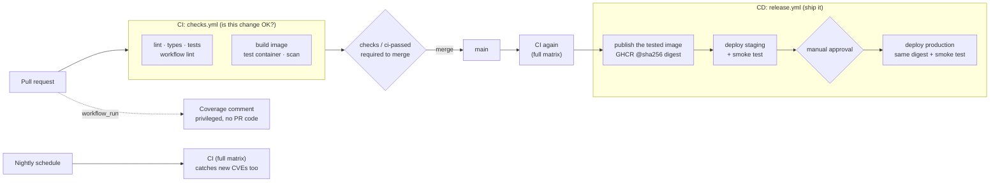

# Taskflow

[](https://github.com/OWNER/taskflow/actions/workflows/ci.yml)
[](https://github.com/OWNER/taskflow/actions/workflows/release.yml)
[](https://github.com/OWNER/taskflow/actions/workflows/nightly.yml)

A small to-do API (FastAPI) with a **production-grade GitHub Actions CI/CD pipeline**:
every pull request is linted, type-checked, tested, built into a container image and the
image itself tested and scanned (CI); every merge publishes that tested image, deploys it
to staging, smoke-tests it, and promotes it to production after manual approval (CD).
`main` only changes through pull requests whose checks passed.

**Live:** [staging](https://STAGING-URL) · [production](https://PRODUCTION-URL) ·
each `/health` endpoint reports the deployed commit SHA.

## How a change ships

1. **Push a feature branch.** Nothing runs yet; `main` cannot be pushed to directly.
2. **Open a pull request into `main`.** CI runs on every push to the PR.
3. **CI passes.** `checks / ci-passed` must be green.
4. **Review.** Recommended, not enforced: the repo has a single maintainer and GitHub does not
   let authors approve their own PRs. With a team, set required approvals to 1 in the ruleset.
5. **Merge.** That push to `main` starts the release: CI runs again on the merged code,
   then the tested image is published and deployed to **staging**.
6. **Approve production.** After the staging smoke test passes, a reviewer approves the
   `production` environment and the **same image digest** goes live.

Each environment's registry tag (`:staging`, `:production`) moves to the deployed digest only
after its smoke test passes, so GHCR always shows what each environment runs.
Both environments only accept deploys from `main`.

## The pipeline



| Workflow | Trigger | What it does |
|---|---|---|
| [`ci.yml`](.github/workflows/ci.yml) | Pull requests | Calls `checks.yml` with a fast Linux matrix; cancels superseded runs |
| [`checks.yml`](.github/workflows/checks.yml) | Called (reusable) | **CI.** Code: lint (ruff), strict types (mypy), workflow lint + security scan (actionlint, zizmor), tests on Python 3.12–3.14 (+ Windows in full mode), coverage. Artifact: Dockerfile lint (hadolint), image build, container tests ([`scripts/test-image.sh`](scripts/test-image.sh)), vulnerability scan (Trivy). One gate job: `ci-passed` |
| [`release.yml`](.github/workflows/release.yml) | Push to `main` | **CD.** CI (full matrix) → publish the image CI tested → staging → approval → production, each deploy verified by a smoke test and then recorded as the `:staging` / `:production` tag |
| [`nightly.yml`](.github/workflows/nightly.yml) | Daily schedule | Full cross-platform matrix against `main` |
| [`coverage-comment.yml`](.github/workflows/coverage-comment.yml) | After CI | Posts coverage on PRs (fork-safe: never executes PR code) |

**Container tests** (run on the built image, before it can be published): non-root user ·
size budget · no tests or dev dependencies inside · starts and honors `$PORT` · `/health`
reports the exact commit · full to-do CRUD over HTTP · serves the UI · clean shutdown on SIGTERM.

**Security and reliability practices:** ruleset on `main` (pull request + green
`checks / ci-passed` required, no force pushes, no bypass) · least-privilege `permissions:` per job ·
actions and the base image pinned to SHAs/digests and kept current by Dependabot (7-day cooldown) ·
`persist-credentials: false` on checkout · environment-scoped deploy secrets ·
protected production environment with required reviewer · deploys by immutable image
digest · per-environment concurrency (deploys queue, never cancel) · job timeouts ·
environments deploy only from `main` · composite actions for setup, deploy and tagging logic.

## Run it locally

```bash
python -m venv .venv && source .venv/bin/activate   # Windows: .venv\Scripts\Activate.ps1
pip install -r requirements-dev.txt
ruff check . && mypy && pytest -v
uvicorn app.main:app --reload                        # http://localhost:8000
```

Or with Docker: `docker build -t taskflow . && docker run -p 8000:8000 taskflow`.
Test the image like CI does: `bash scripts/test-image.sh taskflow dev` (needs curl and jq).

## API

| Method | Path | Description |
|---|---|---|
| `GET` | `/health` | Status and deployed version (commit SHA) |
| `GET` | `/api/todos` | List to-dos |
| `POST` | `/api/todos` | Create `{"title": "..."}` |
| `GET` | `/api/todos/{id}` | Get one |
| `PATCH` | `/api/todos/{id}` | Update `{"title"?, "done"?}` |
| `DELETE` | `/api/todos/{id}` | Delete |

Data is in memory by design: the project's focus is the delivery pipeline.

## Repository layout

```
app/                    FastAPI app + minimal web UI
tests/                  pytest suite
Dockerfile              non-root production image; APP_VERSION baked in at build
scripts/test-image.sh   container tests for the built image
.github/workflows/      the pipeline (see table above)
.github/actions/        composite actions: setup-python-project, deploy-render, tag-image
```
